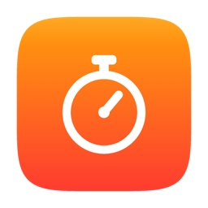
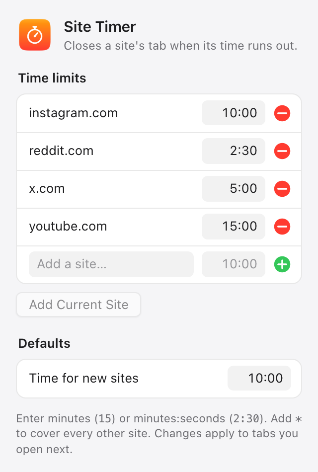
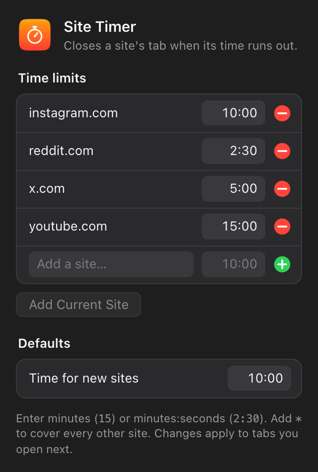
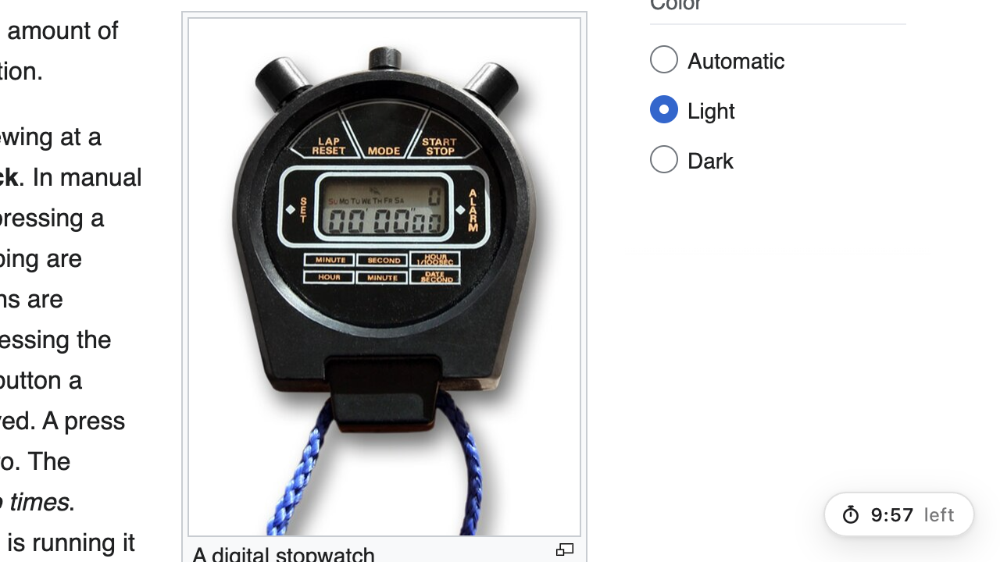
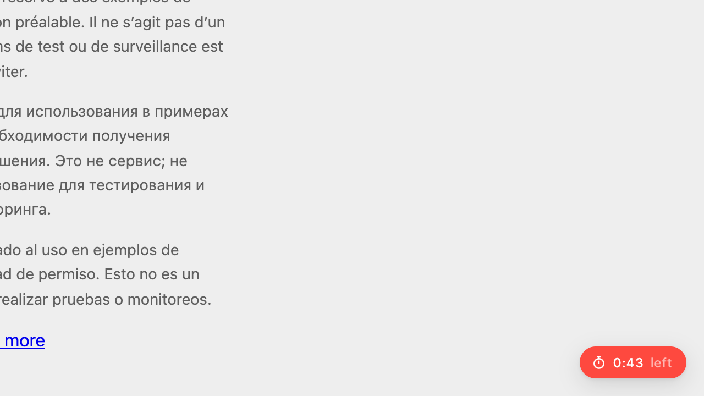

<p align="center">
  
</p>

<h1 align="center">Site Timer</h1>

<p align="center">
  Give each website a time limit. When it runs out, the tab closes.<br>
  A small browser extension to stop doomscrolling.
</p>

<p align="center">
  <a href="https://github.com/abhijitkar10/site-timer/releases/latest"></a>
  
  
  <a href="LICENSE"></a>
</p>

<p align="center">
  
  &nbsp;&nbsp;
  
</p>

## How it works

1. You give a site a time limit, like `youtube.com 15:00` or `reddit.com 2:30`.
2. Opening that site starts a countdown in the corner of the page.
3. In the last minute the timer turns red.
4. At zero you get a notification and the tab closes. Opening the site again starts a fresh countdown.

| Counting down | Last minute |
| :---: | :---: |
|  |  |

Sites without a limit show a count-up timer, so you can see how long you've been anywhere. The timer only counts while the tab is on screen, and clicking it hides it for that page.

## Install

On macOS, one command downloads the extension to `~/.site-timer`, opens your browser's extensions page and copies the folder path:

```bash
curl -fsSL https://raw.githubusercontent.com/abhijitkar10/site-timer/main/install.sh | bash
```

Then, once per browser:

1. Turn on **Developer mode** (top right of the extensions page).
2. Click **Load unpacked**.
3. Press <kbd>⌘</kbd><kbd>⇧</kbd><kbd>G</kbd>, paste with <kbd>⌘</kbd><kbd>V</kbd>, press <kbd>Return</kbd>, then **Select**.

To install for one browser only, add its name: `... | bash -s helium`.
Browsers don't let scripts add extensions on their own, which is why those three clicks stay manual.

**Other systems, or without the script:** download the [latest release](https://github.com/abhijitkar10/site-timer/releases/latest), unzip it, and **Load unpacked** the folder.

**Updating:** run the command again, then click the reload arrow on Site Timer's card in the extensions page.

## Settings

Click the Site Timer icon in the toolbar. If it isn't there, pin it from the puzzle-piece menu.

| Setting | What it does |
| --- | --- |
| **Time limits** | One row per site. Edit a time in place, or remove a site with ⊖. |
| **Add a site…** | Type a site (a full URL works too) and a time, then press <kbd>Return</kbd>. |
| **Add *current site*** | Adds the site you're on with the default time. |
| **`*`** | Adding `*` as a site gives every other site that limit. |
| **Time for new sites** | Used when you add a site without typing a time. |

Times are minutes (`15`) or minutes:seconds (`2:30`, `0:45`). A limit for `youtube.com` also covers `m.youtube.com` and `music.youtube.com`. Changes apply to tabs you open next.

Notifications need your browser allowed in **System Settings → Notifications**.

## Privacy

Nothing leaves your browser. There are no servers, analytics or network requests; your limits are kept in the browser's own extension storage.

| Permission | Why |
| --- | --- |
| Read pages on all sites | To show the timer on whatever site you open. |
| `storage` | To remember your time limits. |
| `notifications` | To tell you when a tab was closed. |
| `activeTab` | To read the current site's address for **Add current site**. |

## Project layout

| File | Role |
| --- | --- |
| `manifest.json` | Extension manifest (Manifest V3). |
| `timer.js` | Content script: draws the timer and runs the countdown. |
| `background.js` | Service worker: closes the tab and shows the notification. |
| `popup.html`, `popup.js` | The settings window. |
| `defaults.js` | Default limits and the shared settings loader. |
| `install.sh` | macOS installer. |

There's no build step. To work on it, clone the repo and **Load unpacked** the folder; after editing, click the reload arrow on the extension's card.

## License

[MIT](LICENSE)
